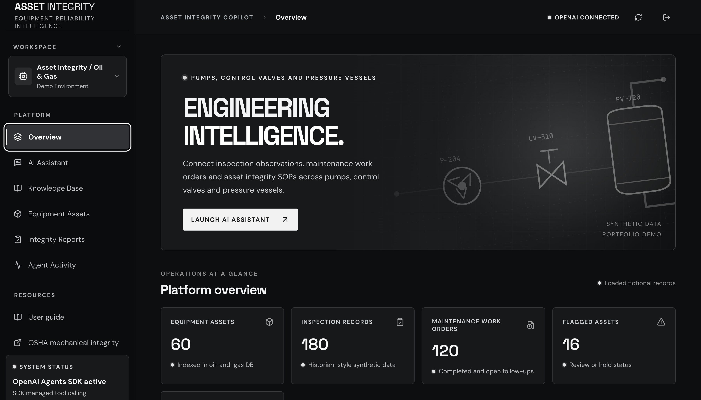

# Asset Integrity Copilot

An AI assistant for reviewing equipment records in an oil and gas facility. You ask about a pump, control valve or pressure vessel, and an agent pulls its inspection readings, work orders and incidents from a database, finds the relevant procedures, and writes a summary that cites where each fact came from.

All plant data in this repo is synthetic: 60 assets, 180 inspections, 120 work orders, 12 incidents and 15 procedure documents.

**Live demo:** https://asset-integrity-copilot.onrender.com/ (the live agent calls a paid API, so it's password-protected; access code is available on request)




## Stack

React and TypeScript (Vite), FastAPI, OpenAI Agents SDK, BM25 with optional OpenAI embeddings, SQLite, Docker on Render.

## How it works

```text
React UI ──POST /api/chat──► FastAPI ──► Agents SDK Runner
                                           ├─ search_documents(query)      → BM25 (+ embeddings)
                                           ├─ get_asset(asset_id)          → SQLite
                                           └─ get_asset_history(asset_id)  → SQLite
                                         output guardrail
                              ◄── answer + sources + tool trace
```

The agent has three tools, all read-only. It can't run SQL, write records or approve anything. Reports are drafted and approved through separate endpoints that only the UI calls, and approval needs an explicit confirmation.

Before an answer is returned, an output guardrail checks every ID in it against what the tools actually returned during that run: document IDs (like `SOP-PMP-001`) against `search_documents`, and record IDs (like `INC-012` or `WO-PV-120-02`) against all tool outputs. Answers citing anything that wasn't retrieved are blocked, as are answers claiming the agent approved or changed something.

Without an API key and password the app runs in offline mode: the same database and keyword search, with a deterministic summary instead of a model. That's useful for running it locally without spending anything.

More detail in [docs/ARCHITECTURE.md](docs/ARCHITECTURE.md).

## Example questions

| Tag | Scenario |
|---|---|
| `P-204` | Rising vibration and a mechanical seal leak (incident INC-007) |
| `CV-310` | Actuator lag and positioner feedback mismatch (INC-010) |
| `PV-120` | Wall thickness trend and external corrosion (INC-012) |

Try "Investigate P-204", or something it should decline, like "Is PV-120 safe to restart?"

## Retrieval evaluation

Keyword retrieval on 36 hand-labelled questions and 10 off-topic ones:

| Hit@1 | Hit@3 | MRR@3 | Off-topic rejected |
|---:|---:|---:|---:|
| 91.7% | 100% | 0.958 | 10/10 |

Adding near-miss questions ("best pizza for a pump party") exposed a bug where a single matching word made any question look relevant. Off-topic rejection was 5/10 before the fix. The write-up is in [docs/EVALUATION.md](docs/EVALUATION.md). The questions were written with the documents in view, so treat these numbers as a regression check. Results from testing the live agent, including a guardrail bug they uncovered, are in the same file.

## Running locally

Requires Python 3.11+ and Node 20+.

```bash
cp .env.example .env            # add OPENAI_API_KEY and DEMO_PASSWORD for live mode
python3 -m venv .venv && source .venv/bin/activate
pip install -r backend/requirements-dev.txt
PYTHONPATH=backend uvicorn app.main:app --reload --port 8000

# in a second terminal
cd frontend && npm ci && npm run dev    # http://localhost:5173
```

On macOS, `bash run-mac.command` does all of the above.

Live mode turns on only when both `OPENAI_API_KEY` and `DEMO_PASSWORD` are set. See `.env.example` for the other settings (model, embeddings, spend cap, rate limit).

## Tests

```bash
python -m pytest -q                                              # 28 offline tests
PYTHONPATH=backend python backend/scripts/evaluate_retrieval.py  # retrieval metrics
ruff check backend && (cd frontend && npm run format:check && npm run build)
```

The SDK tests mock `Runner`, so they check the wiring (tools, context, guardrail) without calling the API. CI runs all of the above on every push.

## Deployment

The Dockerfile builds the frontend and serves it from FastAPI, so it's a single service. On Render, create a Docker web service from this repo (or use `render.yaml`) and set `OPENAI_API_KEY` and `DEMO_PASSWORD` as environment variables.

On Render's free tier the instance sleeps when idle and the filesystem resets on redeploy, so approved reports and usage counters don't persist. The seed data is reloaded on startup.

## Project layout

```text
backend/
  app/
    main.py           routes, auth, rate limiting
    agent.py          system prompt, tool dispatcher, offline mode, spend tracking
    sdk_runtime.py    Agents SDK agent, tools, output guardrail
    retrieval.py      BM25, embeddings, relevance check
    db.py             SQLite schema, queries, reports
  data/               seed data, documents, and the scripts that generate them
  scripts/            retrieval evaluation
  tests/
frontend/src/
  App.tsx             pages and state
  components.tsx      shared UI pieces
  api.ts, types.ts    API client and types
docs/                 architecture and evaluation notes
```

## Limitations and next steps

- No agent-level eval yet: tool-call accuracy, citation validity and refusal rate on a fixed question set.
- The guardrail checks that cited IDs were retrieved, not that numbers, dates or trends are described correctly.
- Retrieval has no stemming, so "leaks" doesn't match "leak".
- SQLite on an ephemeral disk; Postgres would be needed for anything persistent.

## Disclaimer

The documents were written for this project and loosely follow mechanical integrity recordkeeping themes such as [OSHA 29 CFR 1910.119(j)](https://www.osha.gov/laws-regs/regulations/standardnumber/1910/1910.119). They aren't real procedures and contain no design limits. The app doesn't make or support equipment safety decisions, so don't upload real plant documents to it.
